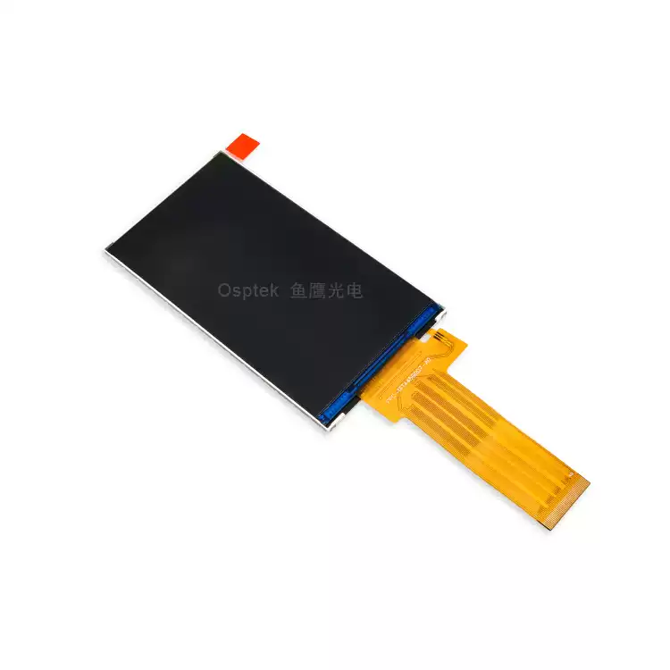

<p align="left"></p>

<h1 align="center">OSPTEK 4.45″ TFT Display 480×854 (YDP445B003-V1)</h1>

<p align="center"><b>TFT module · MIPI · ST7701S</b></p>

<p align="center"><a href="./README.md">简体中文</a> | English · <a href="../../README_EN.md">Family index</a></p>

<p align="center">
  
  
</p>

<p align="center"></p>

## Contents

- [Specifications](#specifications)
- [Resources](#resources)
- [Repository layout](#repository-layout)
- [Buy](#buy)
- [Support](#support)

---

## Specifications

| Item | Spec |
| ---- | ---- |
| Size | 4.45 inch |
| Type | TFT |
| Resolution | 480×854 |
| Outline | 60.0 x 109.0 x 2.15 mm |
| Active area | 55.44 x 98.64 mm |
| Interface | MIPI |
| Driver IC | ST7701S |
| Touch IC | — |

> Full outline, FPC definition, power, and timing follow the product datasheet / driver IC datasheet.

## Resources

| Category | File |
| ---- | ---- |
| Datasheet | [`ST7701S_SPEC_ V1.3.pdf`](./datasheets/ST7701S_SPEC_%20V1.3.pdf) |
| Datasheet | [`YDP445B003-V1.pdf`](./datasheets/YDP445B003-V1.pdf) |
| CAD file | [`YDP445B003-V1.dwg`](./cad/YDP445B003-V1.dwg) |
| CAD file | [`YDP445B003-V1_外形图.pdf`](./cad/YDP445B003-V1_%E5%A4%96%E5%BD%A2%E5%9B%BE.pdf) |

## Repository layout

```text
display-tft-4.45inch-480x854/ # repo root (nav: ../../README_EN.md; sample projects under root examples/)
└── versions/
    └── YDP445B003-V1/        # full materials for this part number
        ├── README.md
        ├── README_EN.md
        ├── osptek.yml
        ├── images/
        ├── datasheets/       # product datasheet + driver/touch IC datasheets
        └── cad/              # outline/cover CAD
```

## Buy

See the [repo home page](../../README_EN.md#where-to-buy).

## Support

See the [repo home page](../../README_EN.md#support).

---

<p align="center"><sub>© 2026 OSPTEK · Materials in this repository are licensed under CC BY 4.0</sub></p>
